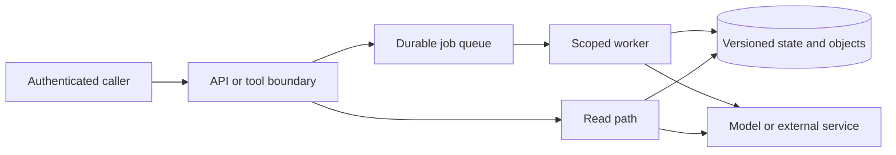

# Production deployment playbook

These are proposed designs for evolving the tutorials. Use each project's LEARNINGS.md for its specific recommendation. No service in this collection has been deployed or load-tested as part of the source port.

## Pick a boundary that matches the workload

| Workload | Initial deployment | Persist outside the process | Scale when evidence warrants it |
| --- | --- | --- | --- |
| RAG query | Stateless API plus persistent vector store | Document IDs, versions, ACLs, embeddings | Query replicas and a separately provisioned model endpoint |
| Ingestion/extraction | Queue plus asynchronous workers | Source objects, job status, checksums, parser/schema version | Parser and embedding workers independently |
| Agent workflow | Job submission API plus durable workers | Step IDs, state, tool results, approvals, idempotency keys | Worker concurrency under tool/vendor quotas |
| MCP tools | Local stdio for one client; authenticated shared transport otherwise | Resource ownership, state and operation IDs | Separate services when tool permissions/capacity differ |
| Streaming voice | Long-lived session workers | Minimal session state and consented artifacts | Capacity by concurrent sessions; drain sessions on deployment |
| Media generation | Async jobs plus artifact storage | Scripts, segment manifests, intermediate audio/images | GPU generation separately from CPU assembly |
| Training | Ephemeral GPU batch jobs | Data/reward versions, checkpoints, tokenizer and adapter lineage | Managed jobs or reserved capacity based on utilization |
| Evaluation | Reproducible batch runner and sandboxed candidate execution | Tasks, prompts, raw responses, judgments, test results | Parallel tasks with bounded provider spend |

## Minimum useful architecture

A personal deployment may combine API and worker on one host while preserving separate functions and durable storage. A distributed deployment needs shared state and explicit retry semantics; copying a process-local dictionary into multiple replicas creates inconsistent behavior.

## Make releases reproducible

Record application commit, Python/Node version, resolved dependency lock, model/adapter revision, tokenizer/preprocessing configuration, prompt/tool/schema revision and vector-index version. Model aliases and mutable container tags are insufficient release identifiers. Resolve and test each project's dependencies independently; preserving an old lockfile is evidence of the tutorial's environment, not proof it is safe or compatible today.

Build a minimal runtime image, run it as an unprivileged user, keep secrets out of layers and mount persistent state explicitly. Scan the built artifact and review reachable findings. GPU workloads need an explicit CUDA/driver/runtime compatibility check against the selected hardware.

## Control work and permissions in code

Validate input shapes and sizes before expensive work. Bound network calls, tool count, recursion, tokens, job duration and concurrent requests. Use least-privilege credentials for data stores and tools. Apply tenant filters inside storage queries and authorize every retrieved document or operation. Treat fetched content and model outputs as data requiring validation.

An agent that can read a document should not automatically gain authority to publish a message, execute generated code, remove artifacts or modify a database. Persist approvals and idempotency keys for consequential external effects. Execute generated code and browser tasks in disposable workers with restricted filesystem and network access.

## Prove reliability and quality together

Before release, test missing credentials, provider errors, rate limits, slow services, worker restart, duplicated delivery, invalid model output and unavailable storage. For stateful systems, perform a restore exercise. For a schema or embedding change, build a new version and switch traffic after validation; keep the previous version for rollback.

Measure quality on a versioned holdout along with latency and cost under representative concurrency. Useful telemetry includes request/job ID, stage duration, selected source/tool IDs, model version, token usage, error category, retry count and final task status. Avoid treating a generated success message as proof a tool operation succeeded.

## Cost and architecture choices

Start with managed inference when it lowers operational work and fits data-handling requirements. Use local inference when measured privacy, latency or utilization justifies the model memory and maintenance cost. A GPU's hourly price must be divided by successful completed work, including idle time and retries.

Do not introduce Kubernetes simply because a prototype has multiple libraries. A small managed container deployment or VM plus managed storage is often enough initially. Durable orchestration becomes valuable when jobs outlive requests, have external side effects or must resume after failures.

The project-specific guides recommend boundaries and experiments; selecting a cloud vendor, instance size or service-level target requires the actual workload measurements and budget.
